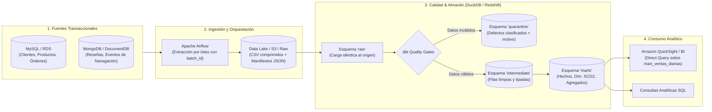

# Data Warehouse & Data Lakehouse de Comercio Electrónico (Local & AWS)

Plataforma integral de ingeniería de datos para un e-commerce colombiano. Modela y procesa datos transaccionales (MySQL) y eventos de navegación/reseñas (MongoDB), implementa control de calidad con esquema de **cuarentena**, construye un modelo analítico en **constelación de hechos** con dimensiones de cambio lento (**SCD Tipo 2**) usando **dbt**, y orquesta el pipeline completo con **Apache Airflow**.

El proyecto está diseñado para ejecutarse en dos modalidades:
1. **Modo Local (Docker + DuckDB):** 100% gratuito, rápido y contenido en contenedores para desarrollo y validación offline.
2. **Modo Cloud (AWS Enterprise):** Despliegue modular en AWS mediante Terraform (VPC, S3 Lakehouse, RDS MySQL, DocumentDB, Redshift Serverless, EC2 con Airflow y Dashboard en Amazon QuickSight).

---

## Arquitectura General



### Glosario de Recursos en AWS

Para facilitar la identificación de los recursos en la nube, el proyecto utiliza una convención temática:

| Recurso en AWS | Identificador | Función en la Arquitectura |
|---|---|---|
| **VPC** | `el-barrio-dw` | Red privada aislada donde residen todos los servicios (3 subredes en `us-east-2`). |
| **Internet Gateway** | `la-puerta-al-mar-dw` | Salida controlada hacia Internet para la VPC. |
| **S3 Bucket (Data Lake)** | `la-bodega-del-pelao-dw-<ID_CUENTA>` | Almacenamiento crudo versionado e inmutable para lotes y manifiestos. |
| **Security Groups** | `el-portero-*` | Reglas de firewall que restringen tráfico únicamente a tu IP pública. |
| **EC2 (Airflow & dbt)** | `el-compadre-dw` | Servidor de procesamiento y orquestación con Docker. |
| **RDS MySQL** | `el-sancocho-dw` | Base de datos relacional transaccional (clientes, pedidos, productos). |
| **DocumentDB** | `el-bololo-dw` | Clúster de documentos compatible con MongoDB (eventos y reseñas). |
| **Redshift Serverless** | `la-picotera-dw` | Data Warehouse analítico columnar (Workgroup de 4 RPU). |
| **Roles de IAM** | `el-compadre-airflow-rol` / `la-picotera-lee-la-bodega` | Políticas de privilegios mínimos para que los servicios lean el S3 y secretos. |

---

## Prerrequisitos del Sistema

Antes de iniciar, asegúrate de contar con:
- **Sistema Operativo:** Linux o Windows con **WSL 2** (Ubuntu 22.04 o 24.04 recomendado). Todos los comandos se ejecutan en bash dentro de la raíz del proyecto.
- **Git** instalado.
- **Docker Desktop** (con integración WSL 2 activa) o Docker Engine con Compose v2.
- **Terraform** v1.5+ (si vas a desplegar en AWS).
- **AWS CLI** v2 (si vas a desplegar en AWS).

---

## Opción A: Inicio Rápido en Local (Docker + DuckDB)

Ideal para probar el flujo de datos, la calidad y el modelo estrella de forma inmediata, en local y sin costos de nube.

### 1. Clonar y configurar variables
```bash
git clone https://github.com/JSLM10/Arquitecturas_De_datos.git
cd Arquitecturas_De_datos
git checkout datawarehouse

# Genera el archivo .env a partir de las plantillas
./scripts/configure_environment.sh
```

### 2. Ejecutar el pipeline completo
```bash
./scripts/run_pipeline.sh
```
*Este comando levanta los contenedores de MySQL, MongoDB y Airflow, genera datos sintéticos reproducibles (`--seed 42`), inyecta defectos controlados y dispara el DAG `ecommerce_pipeline` en Airflow.*

### 3. Acceder a los servicios
* **Airflow UI:** [http://localhost:8080](http://localhost:8080) (Usuario: `airflow`, Clave: `airflow`).
* **DuckDB local:** Los archivos de base de datos se generan en la carpeta local `warehouse/`. Puedes inspeccionar los esquemas conectando DBeaver a `warehouse/ecommerce.duckdb`.

### 4. Comandos útiles en modo local
| Objetivo | Comando |
|---|---|
| Levantar servicios sin regenerar datos | `./scripts/start_infrastructure.sh` |
| Detener contenedores conservando datos | `./scripts/stop_infrastructure.sh` |
| Ejecutar transformaciones dbt completas | `./scripts/run_dbt.sh` |
| Limpiar contenedores, volúmenes y base DuckDB | `./scripts/reset_environment.sh` |

---

## Opción B: Despliegue Empresarial en AWS (Paso a Paso Desde Cero)

Sigue estos pasos en orden para desplegar la arquitectura completa en tu propia cuenta de AWS.

> **Gestión de Costos:** Los recursos en la nube facturan por hora mientras estén encendidos (especialmente EC2, DocumentDB y RDS). Al finalizar tus pruebas, corre el script de destrucción indicado en el **Paso 10**.

---

### Paso 0: Preparación de la Cuenta e Identidad en AWS

#### 0.1 Configurar tu perfil de AWS CLI
Asegúrate de tener un perfil configurado en tu máquina local. Por convención los scripts usan `user_cli`, pero puedes usar `default` definiendo `export AWS_PROFILE="tu_perfil"`.
```bash
aws configure --profile user_cli
```
Verifica tu identidad:
```bash
aws sts get-caller-identity --profile user_cli
```

#### 0.2 Permisos de IAM para roles de EC2
El usuario de AWS CLI necesita permisos para crear y pasar perfiles de instancia a la EC2. En el repositorio se incluye la plantilla [iam/05_user_cli_dw_roles_ec2.json](file:///c:/Users/juanp/Desktop/actividad-DataLake-DataWarehouse/iam/05_user_cli_dw_roles_ec2.json):
1. Entra a la **Consola de AWS** con tu usuario administrador.
2. Ve a **IAM -> Políticas -> Crear política** (pestaña JSON).
3. Pega el contenido de `iam/05_user_cli_dw_roles_ec2.json`.
4. Nómbrala `user_cli-dw-roles-ec2` y créala.
5. Asigna la política a tu usuario de AWS (`user_cli`).

#### 0.3 Generar tu par de llaves SSH y obtener tu IP pública
```bash
# 1. Crea la llave SSH (la privada queda protegida en tu máquina)
ssh-keygen -t ed25519 -f ~/.ssh/la-llave-dw -N ""

# 2. Consulta tu IP pública actual
curl -s https://checkip.amazonaws.com
```

#### 0.4 Configurar `terraform.tfvars`
Copia la plantilla de variables e introduce tu IP pública y la ruta a tu llave:
```bash
cp terraform/terraform.tfvars.example terraform/terraform.tfvars
nano terraform/terraform.tfvars
```
Ajusta los siguientes campos:
```hcl
region        = "us-east-2"
perfil        = "user_cli"
mi_ip_cidr    = "TU_IP_PUBLICA/32"  # <-- Ejemplo: "186.99.12.34/32"
llave_publica = "~/.ssh/la-llave-dw.pub"

# Mantén los interruptores apagados por ahora
crear_ec2      = false
crear_rds      = false
crear_docdb    = false
crear_redshift = false
```

#### 0.5 Inicializar Terraform
```bash
cd terraform
terraform init
terraform validate
cd ..
```

---

### Paso 1: Crear Red (VPC), Bodega S3 y Roles IAM
La base de la infraestructura no genera costo fijo por hora.
```bash
terraform -chdir=terraform plan
terraform -chdir=terraform apply
```
*Revisa el plan (~24 recursos a crear) y escribe `yes`. Al finalizar, verás el nombre del bucket S3 generado dinámicamente (`la-bodega-del-pelao-dw-<ID_DE_TU_CUENTA>`).*

---

### Paso 2: Desplegar la EC2 ("El Compadre")
1. Abre `terraform/terraform.tfvars` y cambia:
   ```hcl
   crear_ec2 = true
   ```
2. Aplica los cambios:
   ```bash
   terraform -chdir=terraform apply
   ```
3. Espera 2 a 3 minutos a que termine de aprovisionar Docker y consulta el estado del servidor:
   ```bash
   bash scripts/aws/compadre.sh estado
   ```
   *Debe responder `El compadre esta LISTO` mostrando las versiones de Docker y Compose.*
   *(Para entrar a la máquina por SSH cuando lo desees: `bash scripts/aws/compadre.sh entrar`).*

---

### Paso 3: Desplegar RDS MySQL ("El Sancocho")
1. En `terraform/terraform.tfvars`, activa:
   ```hcl
   crear_rds = true
   ```
2. Aplica:
   ```bash
   terraform -chdir=terraform apply
   ```
   *(Tarda entre 8 y 12 minutos en crearse).*
3. Verifica la conectividad segura privada desde la EC2:
   ```bash
   bash scripts/aws/compadre.sh probar rds
   ```
   *Debe responder con la versión de MySQL y el usuario de administración.*

---

### Paso 4: Desplegar DocumentDB ("El Bololo")
1. En `terraform/terraform.tfvars`, activa:
   ```hcl
   crear_docdb = true
   ```
2. Aplica:
   ```bash
   terraform -chdir=terraform apply
   ```
   *(Tarda entre 10 y 15 minutos).*
3. Prueba la conexión con TLS y certificado:
   ```bash
   bash scripts/aws/compadre.sh probar docdb
   ```
   *Debe responder `DocumentDB -> ping ok, version=5.0.0`.*

---

### Paso 5: Desplegar Redshift Serverless ("La Picotera")
1. En `terraform/terraform.tfvars`, activa:
   ```hcl
   crear_redshift = true
   ```
2. Aplica:
   ```bash
   terraform -chdir=terraform apply
   ```
   *(Tarda ~5 minutos).*
3. Prueba la conexión:
   ```bash
   bash scripts/aws/compadre.sh probar redshift
   ```
   *También puedes abrir la consola de AWS en **Amazon Redshift -> Query editor v2** y conectarte al workgroup usando AWS Secrets Manager.*

---

### Paso 6: Desplegar Pipeline en la EC2 y Cargar Fuentes
Con los cuatro interruptores en `true`, despliega el stack de Airflow en la máquina virtual:

1. **Subir código y levantar Airflow:**
   ```bash
   bash scripts/aws/compadre.sh desplegar
   ```
2. **Obtener credenciales de Airflow:**
   ```bash
   bash scripts/aws/compadre.sh clave-airflow
   ```
   Abre en tu navegador `http://<IP_PUBLICA_EC2>:8080`, ingresa con el usuario `airflow` y la contraseña generada.
3. **Poblar las fuentes sintéticas en RDS y DocumentDB:**
   ```bash
   bash scripts/aws/escenarios.sh reiniciar
   ```
   *(Escribe `si`. Generará 50 clientes, 25 productos, 100 órdenes, 150 reseñas y 500 eventos de navegación con 34 defectos inyectados).*

---

### Paso 7: Carga Inicial (Airflow -> S3 -> Redshift -> dbt)
Ejecuta la primera carga end-to-end:
```bash
bash scripts/aws/escenarios.sh carga-inicial
```
¿Qué sucede durante este proceso?
- Airflow dispara el DAG `ecommerce_dw_aws`.
- Extrae las fuentes en lotes etiquetados con `batch_id`, comprimidos en GZIP hacia S3 junto a un `_manifest.json`.
- Ejecuta comandos `COPY` transaccionales hacia el esquema `raw` de Redshift.
- Corre los modelos dbt: separa registros válidos en `intermediate`, desvía anomalías a `quarantine` y construye las tablas de hechos y dimensiones en `marts`.
- Ejecuta y valida **97 pruebas automáticas de dbt** (`PASS=97 WARN=0 ERROR=0`).

---

### Paso 8: Demostración de Escenarios y Resiliencia
Ejecuta los escenarios de prueba en orden desde la terminal para verificar calidad, idempotencia y recuperación ante desastres:

```bash
# 1. Defectos y Cuarentena: inspecciona registros defectuosos aislados con su motivo de rechazo
bash scripts/aws/escenarios.sh defectuosos

# 2. Idempotencia: reprocesar el mismo lote no duplica filas ni altera los conteos
bash scripts/aws/escenarios.sh repetir-lote

# 3. Carga Incremental: procesa un nuevo lote de datos y verifica el crecimiento de los hechos
bash scripts/aws/escenarios.sh nuevo-lote 1

# 4. SCD Tipo 2: actualiza datos de clientes/productos manteniendo la trazabilidad histórica
bash scripts/aws/escenarios.sh cambio-scd2

# 5. Inyección de Fallo: simula un fallo en la carga de Redshift (demuestra aborto transaccional)
bash scripts/aws/escenarios.sh fallo

# 6. Recuperación: reprocesa el lote fallido directamente desde S3 sin tocar las fuentes
bash scripts/aws/escenarios.sh recuperar

# 7. Conciliación: comprueba que las fuentes cuadren al 100% con fct_sales y el mart analítico
bash scripts/aws/escenarios.sh conciliar

# 8. Auditoría: consulta la historia completa de lotes registrados en ops.lotes
bash scripts/aws/escenarios.sh lotes
```

---

### Paso 9: Visualización en Amazon QuickSight (Opcional)

Si deseas conectar una herramienta de BI empresarial:
1. **Activar QuickSight:** Regístrate en **Amazon QuickSight** en la región `us-east-2` (Ohio).
2. **Crear usuario de solo lectura:** Conéctate a Redshift desde Query Editor v2 y ejecuta:
   ```sql
   create user quicksight_lector password 'TuClaveSegura123!';
   grant usage on schema marts to quicksight_lector;
   grant select on all tables in schema marts to quicksight_lector;
   alter default privileges in schema marts grant select on tables to quicksight_lector;
   ```
3. **Crear Dataset:** Conéctate mediante Redshift a la base `ecommerce_dw`, esquema `marts`, tabla `mart_ventas_diarias` en modo **Direct Query**.
4. **Armar Dashboard:** Agrega un gráfico de barras mensual por categoría, un KPI de ventas totales y un filtro desplegable por canal (`web`, `mobile`, `store`).

---

### Paso 10: Eliminación y Limpieza de Recursos (Crucial)

Para evitar cobros innecesarios en AWS al terminar tus prácticas:

#### Borrar TODO de la cuenta:
```bash
bash destruir_todo.sh
```
*Escribe `si`. El script invocará `terraform destroy` y al final ejecutará automáticamente `verificar_limpieza.sh` para certificar que no quede ningún recurso activo.*

#### Pausar solo lo costoso (si vas a continuar después):
```bash
bash destruir_todo.sh --solo-lo-caro
```
*Apaga EC2, RDS, DocumentDB y Redshift, conservando la red, los roles y la bodega S3 sin costo.*

#### Verificar estado de la cuenta sin modificar nada:
```bash
bash verificar_limpieza.sh
```

---

## Preguntas Frecuentes y Errores Comunes

* **`AccessDenied` al ejecutar Terraform:** Tu usuario de AWS carece de permisos. Revisa el Paso 0.2 y adjunta la política `iam/05_user_cli_dw_roles_ec2.json`.
* **No puedo conectar por SSH a la EC2:** Tu IP pública dinámica cambió. Consulta tu nueva IP con `curl -s https://checkip.amazonaws.com`, actualiza `mi_ip_cidr` en `terraform/terraform.tfvars` y ejecuta `terraform -chdir=terraform apply`.
* **`error reading public key`:** No se encontró la llave SSH. Genera la llave ejecutando el comando del Paso 0.3.
* **Palabra reservada `raw` en Redshift:** En PostgreSQL y Redshift `raw` es una palabra reservada. Si realizas consultas manuales en Query Editor v2, escríbela entre comillas: `SELECT * FROM "raw".mysql_orders LIMIT 10;`.
* **DuckDB database locked (Modo Local):** DuckDB solo admite un proceso escritor simultáneo. Cierra la conexión en DBeaver antes de ejecutar `run_pipeline.sh`.

---

## Documentación Técnica Detallada

Para profundizar en el diseño conceptual y técnico:
* [Arquitectura y flujo de datos detallado](docs/architecture.md)
* [Modelo de datos dimensional, llaves subrogadas y SCD2](docs/data_model.md)
* [Configuración de orquestación con Apache Airflow](docs/airflow.md)
* [Guía de conexiones para DBeaver y MongoDB Compass](docs/connections.md)
* [Consultas analíticas de ejemplo](docs/analytical_queries.sql)
