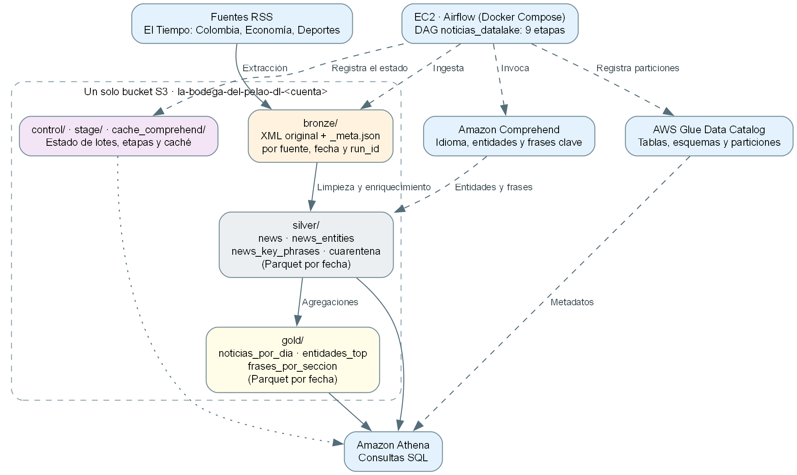

# Data Lake de noticias de El Tiempo en AWS

Pipeline de extremo a extremo que recopila noticias de tres feeds RSS de El Tiempo, las guarda en una arquitectura medallón (Bronze, Silver y Gold) dentro de **un solo bucket de S3**, las enriquece con **Amazon Comprehend**, registra las tablas en **AWS Glue Data Catalog** y las consulta con **Amazon Athena**. **Apache Airflow** corre en una EC2 y orquesta todo el flujo.

Esta carpeta es independiente del Data Warehouse del resto del repositorio. Reutiliza solo dos módulos de Terraform (`red` y `ec2_airflow`).



## Contenido

| Ruta | Qué hay |
|---|---|
| `terraform/` | Bucket, base de Glue con sus 8 tablas, workgroup de Athena, roles de IAM y la EC2 |
| `src/noticias/` | Código del pipeline: Bronze, Silver, Comprehend, Gold, Glue y Athena |
| `src/noticias/fuentes.json` | Fuentes RSS (medio, sección y URL) |
| `src/airflow/dags/noticias_datalake.py` | DAG de Airflow con las 9 etapas |
| `docker/` | Imagen de Airflow y Docker Compose |
| `scripts/compadre.sh` | Atajos para la EC2: desplegar, correr el DAG, ver logs y consultar |
| `scripts/escenarios.sh` | Los escenarios de calidad, incrementalidad y recuperación |
| `destruir_todo.sh`, `verificar_limpieza.sh` | Borrar todo y comprobar que no quede nada cobrando |
| `tests/prueba_local.py` | Prueba de la lógica sin AWS (S3 simulado) |

## Fuentes RSS

| Fuente | Sección | URL |
|---|---|---|
| `colombia` | Colombia | https://www.eltiempo.com/rss/colombia.xml |
| `economia` | Economía | https://www.eltiempo.com/rss/economia.xml |
| `deportes` | Deportes | https://www.eltiempo.com/rss/deportes.xml |

Solo se usa el contenido del RSS (guid, título, enlace, descripción y fecha); no se descargan las páginas. Una respuesta vacía, un error HTTP o un XML malformado no llegan a Bronze: la fuente queda registrada como `fallida` y la corrida como `parcial` o `fallida`, nunca como una fuente sin noticias.

## Capas

El bucket se llama `la-bodega-del-pelao-dl-<cuenta>` y es privado, con versionado y cifrado AES-256.

| Prefijo | Contenido |
|---|---|
| `bronze/source=<fuente>/ingestion_date=AAAA-MM-DD/run_id=<id>/` | `feed.xml` original y `_meta.json` (ejecución, fuente y URL, fecha de ingesta UTC, estado HTTP, hash SHA-256 y ubicación) |
| `silver/news`, `news_entities`, `news_key_phrases` | Parquet particionado por `fecha` (fecha de publicación UTC) |
| `silver/cuarentena` | Rechazados con motivo y archivo de Bronze, particionado por `fecha_ingesta` |
| `gold/noticias_por_dia`, `entidades_top`, `frases_por_seccion` | Parquet particionado por `fecha` |
| `control/lotes/` | Un JSON por corrida y fuente; Athena lo lee como la tabla `ops_lotes` |
| `stage/run_id=<id>/` | Resultados intermedios de una corrida, para reanudarla si falla |
| `cache_comprehend/` | Resultado de Comprehend por hash del texto |
| `athena-resultados/` | Resultados de las consultas |

### Diccionario de datos

**`silver_news`** (una fila por noticia vigente)

| Columna | Descripción |
|---|---|
| `news_id` | guid del RSS o, si no existe, `enlace-` más el hash del enlace |
| `fuente`, `medio`, `seccion` | Feed de origen, medio y sección |
| `titulo`, `descripcion` | Texto sin etiquetas HTML |
| `enlace` | URL de la noticia |
| `publicado_utc`, `publicado_original` | Fecha de publicación en UTC y valor original del RSS |
| `content_hash` | SHA-256 de título y descripción; detecta cambios |
| `texto_analizado`, `texto_hash`, `idioma`, `estado_enriquecimiento`, `analizado_utc` | Lo que se envió a Comprehend, su hash, el idioma, el estado (`completo`, `vacio`, `demasiado_largo`, `idioma_no_soportado`) y cuándo se analizó |
| `primera_ingesta_utc`, `ultima_ingesta_utc` | Primera vez que se vio la noticia e ingesta de la versión vigente |
| `run_id`, `bronze_key` | Trazabilidad hasta el archivo de Bronze |
| `fecha` | Partición |

**`silver_news_entities`** (una fila por entidad distinta en cada noticia): `news_id`, `entidad`, `tipo` (PERSON, ORGANIZATION, LOCATION), `score`, `menciones`, `texto_hash`, `fecha`.

**`silver_news_key_phrases`** (una fila por frase clave distinta en cada noticia): `news_id`, `frase`, `score`, `texto_hash`, `fecha`.

**`silver_cuarentena`**: `run_id`, `fuente`, `guid`, `titulo`, `enlace`, `motivo`, `bronze_key`, `ingestado_utc`, `fecha_ingesta`.

**Gold** (todas cuentan noticias distintas, no menciones):

| Tabla | Granularidad | Métrica `noticias` |
|---|---|---|
| `gold_noticias_por_dia` | fecha, medio, sección | Noticias publicadas |
| `gold_entidades_top` | fecha, tipo, entidad | Noticias que mencionan la entidad |
| `gold_frases_por_seccion` | fecha, sección, frase | Noticias de la sección con esa frase |

Una noticia pertenece a una sola fecha (la de publicación UTC), así que sumar entre días no la cuenta dos veces. Las noticias sin fecha válida van a cuarentena y no entran a Silver ni a Gold. Gold se reconstruye completo desde Silver en cada corrida.

## Reglas de calidad, identificación y actualización

- **Rechazos** (a cuarentena, con motivo y archivo de Bronze): `sin_identificador`, `titulo_vacio`, `enlace_invalido` y `fecha_invalida`.
- **Identificación:** el guid del RSS o el hash del enlace. Una noticia presente en varios feeds se publica una sola vez, con la sección del primer feed según el orden de `fuentes.json`.
- **Clasificación frente a Silver:** nueva (no existía), repetida (mismo `content_hash`), actualizada (mismo id y otro título o descripción) o rechazada. La versión vigente reemplaza a la anterior; el historial queda en Bronze.
- **Comprehend:** se analiza título y descripción; se detecta el idioma (español o inglés) y luego personas, organizaciones, lugares y frases clave. No se vuelve a llamar si el texto no cambió (caché por hash). Los textos vacíos, de más de 5000 bytes o en otro idioma quedan con un estado explícito y sin entidades.
- **Validaciones en Athena** (todas deben dar 0): unicidad de `news_id`, campos obligatorios, fechas y enlaces válidos, entidades sin noticia, frases sin noticia y conciliación de Silver contra Gold.

## Incrementalidad y recuperación

- **Bronze inmutable:** cada corrida guarda su XML; nada se sobrescribe.
- **Incremental:** solo las noticias nuevas o cambiadas pasan por Comprehend, y Silver reescribe solo las particiones afectadas.
- **Idempotente:** cada partición es un archivo de ruta fija (`part-0.parquet`); reescribirla reemplaza el mismo objeto, así que repetir una corrida no deja duplicados. S3 reemplaza cada objeto de forma atómica.
- **Reanudable:** entre tareas viaja solo el `run_id`; los resultados intermedios quedan en `stage/`.
- **Reproceso:** `reprocesar_run=<run_id>` repite una corrida desde Bronze sin consultar los RSS. Si ya estaba publicada, se anota con el sufijo `+reproceso-<fecha>`.
- **Reconstrucción:** `reconstruir=true` borra Silver y Gold y los rehace desde todo Bronze con la caché de Comprehend.
- **Fallo parcial:** Silver se publica en tres tablas en secuencia. Si una tarea falla entre ellas, queda visible un estado parcial hasta reejecutar la corrida, que lo corrige. La corrida queda sin la etapa `publicado`.

## DAG `noticias_datalake`

`validar_configuracion` → `extraer_colombia`, `extraer_economia`, `extraer_deportes` (en paralelo) → `limpiar_validar` → `enriquecer_comprehend` → `publicar_silver` → `construir_gold` → `actualizar_glue` → `validar_athena` → `registrar_estado`.

Dependencias explícitas, 2 reintentos con 30 segundos de espera, logs con corrida y tarea (`[corrida=... tarea=...]`) y una sola ejecución a la vez. Parámetros al disparar el DAG: `reprocesar_run`, `reconstruir`, `registrar_glue`, `simular_fallo` (`enriquecer` o `publicar_silver`) y `fuente_caida`. Para ejecutarlo cada hora: `bash data-lake/scripts/compadre.sh programar on`.

## Despliegue

Requisitos: WSL con Ubuntu 24.04, Terraform, AWS CLI con el perfil `user_cli` (con permisos sobre S3, EC2, IAM, Glue, Athena y Comprehend) y una llave SSH en `~/.ssh/la-llave-dw`. Todos los comandos se corren desde la raíz del repositorio.

```bash
wsl -d Ubuntu-24.04
```

```bash
curl -s https://checkip.amazonaws.com
```

```bash
cp data-lake/terraform/terraform.tfvars.example data-lake/terraform/terraform.tfvars
```

Edita `data-lake/terraform/terraform.tfvars`: pon tu IP con `/32` en `mi_ip_cidr` y `crear_ec2 = true`.

```bash
terraform -chdir=data-lake/terraform init
```

```bash
terraform -chdir=data-lake/terraform apply
```

```bash
bash data-lake/scripts/compadre.sh estado
```

```bash
bash data-lake/scripts/compadre.sh desplegar
```

Airflow queda en `http://<ip-de-la-ec2>:8080` con el usuario `airflow`; la clave sale con `bash data-lake/scripts/compadre.sh clave-airflow`.

## Ejecución y escenarios

```bash
bash data-lake/scripts/escenarios.sh carga-inicial
```

| Escenario | Comando |
|---|---|
| Carga inicial | `escenarios.sh carga-inicial` |
| Registros defectuosos | `escenarios.sh defectuosos` |
| Repetición de un lote exitoso | `escenarios.sh repetir-lote` |
| Nuevo lote incremental | `escenarios.sh nuevo-lote` |
| Noticia con contenido modificado | `escenarios.sh modificado` |
| Fallo controlado | `escenarios.sh fallo` |
| Reejecución de la corrida que falló | `escenarios.sh recuperar` |
| Reprocesamiento desde Bronze | `escenarios.sh reconstruir` |
| Nueva partición | `escenarios.sh nueva-particion` |
| Fuente no disponible | `escenarios.sh fuente-caida` |
| Todos, con resumen | `escenarios.sh todos` |
| Dejar el lago en cero | `escenarios.sh reiniciar` |

Los escenarios de noticia modificada, noticias nuevas, registros defectuosos y fecha nueva usan copias controladas de un RSS ya guardado en Bronze (`compadre.sh cli copia <tipo>`), para no depender de que el medio publique algo durante la demostración.

Consultas de Athena y bytes escaneados con y sin filtro de partición:

```bash
bash data-lake/scripts/escenarios.sh consultas
```

Otras herramientas: `compadre.sh tareas` (estado de las tareas de la última corrida), `compadre.sh log <tarea>`, `compadre.sh sql "<consulta>"` y `compadre.sh cli lotes` (tabla de control).

## Costos aproximados (Ohio)

| Recurso | Precio |
|---|---|
| EC2 t3.large, disco de 30 GB e IP | ≈ $0.09 por hora |
| Amazon Comprehend | ≈ $0.001 por noticia nueva (3 llamadas de mínimo 3 unidades a $0.0001); los textos repetidos no se cobran por la caché |
| Amazon Athena | $5 por TB, mínimo 10 MB por consulta (≈ $0.00005); corte de 10 MB por consulta en el workgroup |
| S3, Glue Data Catalog y red | Prácticamente $0 con este volumen |

Lo que cobra de forma continua es la EC2: apágala o destruye todo cuando no la uses.

## Eliminación

```bash
bash data-lake/destruir_todo.sh
```

Muestra lo que se va a borrar, pide confirmación y ejecuta `terraform destroy`; incluye el bucket y sus datos. Con `--solo-la-ec2` apaga solo la instancia y deja la red, el bucket, Glue y Athena.

```bash
bash data-lake/verificar_limpieza.sh
```

Revisa en la cuenta que no quede ninguna EC2, disco, llave, IP, NAT, VPC, base de Glue, workgroup, bucket o rol del data lake, y termina con `Todo limpio`.

## Seguridad

- Bucket privado con acceso público bloqueado, cifrado y versionado.
- El rol de la EC2 solo accede al bucket del lago, a las API `Detect*` de Comprehend, a la base `el_periodico` de Glue y a Athena.
- SSH y Airflow solo aceptan tu IP (`/32`); la EC2 exige IMDSv2.
- Sin secretos en el código: la configuración llega por variables de entorno y las claves de Airflow se generan una vez dentro de la EC2.
- `terraform.tfvars`, el estado de Terraform, las llaves y las capturas (`evidencias/`) están en el `.gitignore`.

## Limitaciones

- **Comprehend detecta menciones; no resuelve alias.** El mismo nombre puede salir como persona y como organización, un cargo como `presidente` puede contarse como persona y a veces un número suelto se detecta como organización.
- Solo se analizan título y descripción del RSS, solo español e inglés y hasta 5000 bytes por texto.
- Si El Tiempo cambia el guid de una noticia, se tomará como nueva. Una noticia presente en dos secciones se cuenta solo en la del primer feed.
- El escenario de fuente no disponible se comprobó en la prueba local (`tests/prueba_local.py`), no en AWS.
